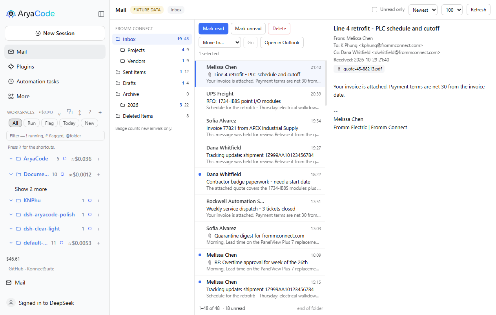
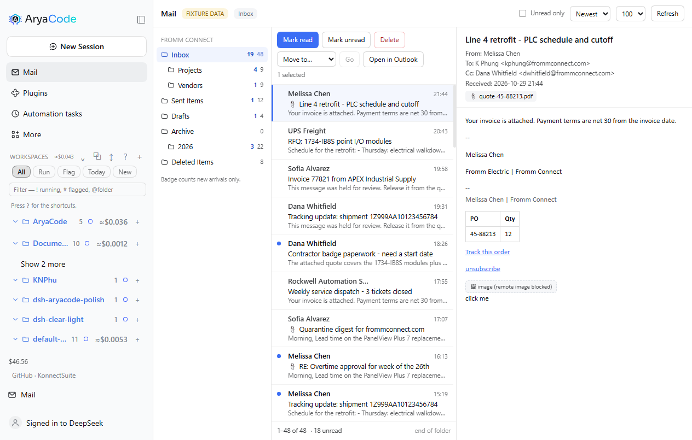
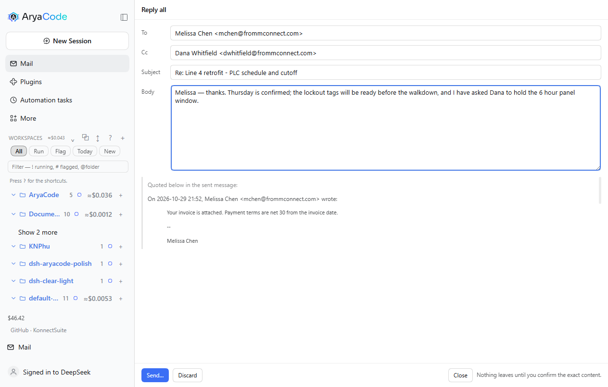
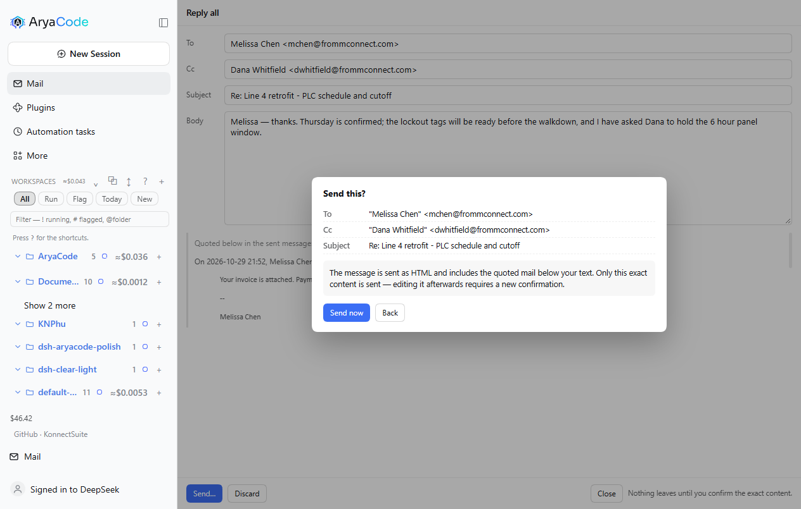
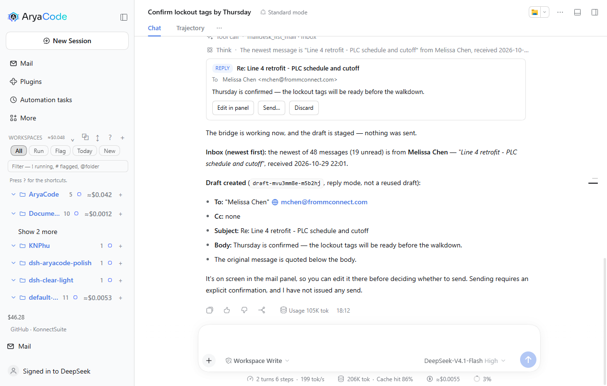
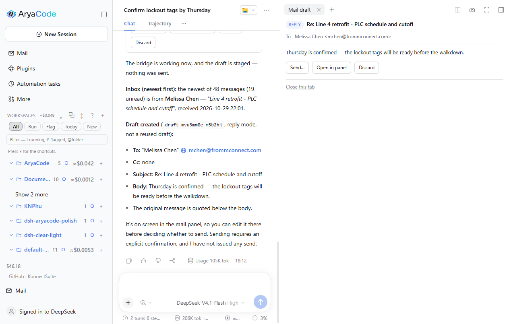

# dsh-arya-maildesk

> **Let an AI drive the Outlook you are already logged into, on a work laptop where IT will not give you a Graph API permission.**
> No credentials, no admin rights, and nothing leaves the machine without asking you first.

[](https://www.npmjs.com/package/@deepseek-ai/dsh) [](https://support.microsoft.com/en-us/office) [](./LICENSE) [](#what-it-delivers)

> **Where this came from.** It started as [UnknowCao/dsh-outlook](https://github.com/UnknowCao/dsh-outlook) at `5a2ec7d` (v2.11.0, MIT): a solid read/send bridge with 18 tools and a badge. The organize half was missing — delete, move/archive, read state, a folder tree, a paged listing — and the interface stopped at the badge, so the mail panel, the composer, the draft card and the Sidebar tab are new here. `NOTICE` keeps the upstream attribution; the upstream version line was retired at 1.0.0, see `CHANGELOG.md`.

*Zero-credential Outlook automation for AI agents on Windows: drives your local desktop Outlook client via COM. No Graph API app registration, no SMTP passwords, no tenant admin rights — everything that leaves the machine passes a three-layer human approval gate.*

## When do you need this?

1. **Your work laptop has classic Outlook, but IT will not let you register an Azure app.** Every Graph API route (outlook-mcp and friends) dies at app registration; this plugin never asks, because it drives the desktop client you are already signed into.
2. **You want the AI to be your mail secretary.** Ask "anything new?" when you sit down; say "reply to this one, Wednesday works" and it drafts, quotes the original, and shows you the result before anything is sent.
3. **You need a meeting and do not know who is free.** One sentence looks up a colleague's free/busy and finds an open room, and you still approve the invite before it goes out.

## What it delivers

**24 AI tools** — reads run on their own, anything that leaves the machine goes through a confirmation popup first:

| Tool | What it does | Gate |
|---|---|---|
| `maildesk_check_new` | New-mail arrivals pushed by the watcher (keeps the sidebar badge in sync) | read-only |
| `maildesk_search_mail` | Search mail (days / folder / sender / subject / date range / recipient side); results can carry a click-to-open link | read-only |
| `maildesk_read_mail` | Full body, recipients and attachment names, truncated when long | read-only |
| `maildesk_open_mail` | Open a mail in a desktop Outlook inspector window (marks it read, badge decrements) | local action |
| `maildesk_list_folders` | **The folder tree** of every store: path, depth, item and unread counts | read-only |
| `maildesk_list_mail` | **One page of a folder**, offset/limit, sortable, unread-only — browse, not search | read-only |
| `maildesk_move_mail` | **Move or archive** one mail or up to 500 at once; returns the new entryIds | local action |
| `maildesk_delete_mail` | **Delete** to Deleted Items (soft, undoable), with a selection-count guard | local action |
| `maildesk_mark_read` | **Mark read or unread**, in bulk | local action |
| `maildesk_account` | Account name and SMTP address | read-only |
| `maildesk_draft_mail` | Create a draft (**never sends**, attachments allowed) | safe |
| `maildesk_send_mail` | Send a mail | three-layer gate |
| `maildesk_reply_mail` | Reply / reply-all / forward (quotes the original, forward carries its attachments) | three-layer gate |
| `maildesk_calendar_query` | The next N days (recurring items expanded) | read-only |
| `maildesk_calendar_create` | Personal appointment directly; with attendees it becomes an invite | invites need approval |
| `maildesk_meeting_requests` | Pending meeting invitations | read-only |
| `maildesk_respond_meeting` | Accept / tentative / decline | approval (notifies the organizer) |
| `maildesk_meeting_update` | Change an appointment or meeting (organizer notifies attendees) | approval |
| `maildesk_meeting_cancel` | Cancel a meeting (notifies attendees) or drop a personal appointment | approval |
| `maildesk_search_people` | Address book (GAL) by name, email or alias | read-only |
| `maildesk_freebusy` | A colleague's busy/free blocks, 30-minute resolution | read-only |
| `maildesk_search_rooms` | Room search plus availability for a given window | read-only |
| `maildesk_save_attachment` | Save an attachment to disk (no path traversal, never overwrites) | local write |

**Plus a sidebar badge.** New mail shows a red count on the Outlook button; clicking it lists the latest arrivals and **clicking one opens it in Outlook** (marked read, count decrements). Hover previews the list. A `[Open](…)` markdown link in the chat works the same way: the plugin intercepts the left click in-page, so there is no stray tab, and a toast confirms at the bottom.

| Expanded (outside badge) | Collapsed (dot inside the circle) |
|---|---|
|  |  |

## The mail panel




A **Mail** icon in the sidebar opens a three-pane mailbox: folder rail, message list with a real selection (click, shift-range, ctrl-toggle), reading pane, and the organize actions — mark read or unread, move to a folder, delete to Deleted Items. A page loads 100 rows and pages on demand; the unread-only filter and the sort run in Outlook, not in the browser.

The data path is one allowlisted host route, `POST /maildesk/api/call`, guarded by the same origin check as the badge. It accepts `account`, `list_folders`, `list_mail`, `read_mail`, `mark_read`, `move_mail`, `delete_mail` and `open_mail`. **Sending is not on that list**, and cannot be reached through it.

No Outlook on this machine? `MAILDESK_FIXTURE=1` serves a synthetic mailbox and the header says `FIXTURE DATA`, so the interface can be developed and reviewed without COM. It is opt-in on purpose: a COM failure is reported as an error, never answered with invented mail.

### Reading mail safely



HTML bodies are parsed and rebuilt against an allowlist rather than injected: known tags and attributes survive, `<script>`, `<style>` and the embedding family are dropped with their contents, every `` becomes a *remote image blocked* chip so a tracking pixel never sends a read receipt, and only `http:`, `https:`, `mailto:` and `tel:` links survive with `rel="noopener noreferrer"`. Style properties are allowlisted too, so `url()`, `expression()` and `behavior` cannot come back in through CSS.

Proofpoint rewrites inbound URLs. The reader unwraps both the `urldefense.proofpoint.com/v2/url?u=…` and the `…/v3/__…__;…` forms, so a vendor link opens the vendor and the target you inspect is the one you will actually visit. The bridge returns `HTMLBody` raw — it is the renderer, which owns a document parser, that decides what survives.

### Replying from the panel



Reply, Reply all and Forward open a composer over the panel with the recipients already resolved from the thread, a `Re:` subject, and the quoted original rendered underneath the body. The draft is **not** an Outlook item: it lives in the host half, keyed by account and thread, so asking for the same reply twice reuses one draft instead of stacking a second in Outlook's Drafts folder. Nothing is written to Outlook until you send.



Sending is two steps on purpose. **Send…** asks the host for a confirmation hash over the exact arguments — recipients, subject and the final HTML body including the quote — and shows what will leave. **Send now** returns that hash; the host recomputes it and refuses a mismatch. Editing the draft between the two steps changes the hash, so a confirmation can never outlive the content it approved. The bridge keeps its own gate underneath: `compose_send` still demands the one-time `OLK_CONFIRM` token, and the host mints it only after a human has clicked through both steps.

The body is sent as `HTMLBody`, and the quote is rebuilt through a stricter path than the reading pane's: script, style, frames, forms and `on*=` handlers are removed **with their contents** before they are copied into an outbound message.

### The draft in the conversation



Asking the agent to draft a reply puts a card in the conversation instead of a line of JSON: the mode, the subject, the addressing, the body, and `[Edit in panel] [Send…] [Discard]`. The card is a keyed `tool.call.toolview` entry for the `maildesk_compose` tool, so it renders only that call and leaves every other tool row alone.

The card is a view of the same host-owned draft the panel edits, not a copy. There is no push channel from the host to the page in this harness, so the card polls `POST /maildesk/api/draft` with `op: "get"` and settles on whatever the panel last stored — editing in the panel and returning to the chat shows the edit. `Send…` uses the same two-step hash gate; `Edit in panel` switches to the Mail panel and opens the composer on that very draft, so there is still only one draft per thread no matter which surface started it.

### The draft beside the conversation



`[Open beside chat]` puts the same draft in a tab of the right Sidebar, so the thread you are answering stays on screen while you send. It is a real Sidebar tab — a `sidebarRightTabs` type plus its keyed `sidebar.right.pane.tab` body — not an overlay, so it collapses, splits and closes the way the harness's own tabs do.

The tab carries `[Send…] [Open in panel] [Discard]` and a `Close this tab` link, and it reads the draft from the same `op: "get"` route as the card. Sending from it cannot send stale content: if the draft changes between the preview and the confirmation, the retry no longer matches the hash and the tab asks you to send again rather than sending what you did not read.

## Quick start

```sh
# short name from npm (recommended)
dsh plugin --profile web add dsh-arya-maildesk
```

Then restart the profile (or rely on `patchReload: live`). There is no second step — no credential, no app registration, no Outlook setting to change.

**Prerequisites**: Windows + classic desktop Outlook (Win32 `OUTLOOK.EXE`) signed in + Windows PowerShell 5.1 (ships with the OS). No tenant admin rights.

> Published as `dsh-arya-maildesk` 1.0.0. It coexists with upstream's `dsh-outlook`: different package, different tool prefix (`maildesk_*` vs `outlook_*`), so neither shadows the other.

## Try saying

- "Anything new?"
- "Find the mail from the vendor last week about the deliverables"
- "Forward this to Dana and ask her to confirm"
- "Set up a meeting with Wei next Wednesday — check when he is free first"
- "Find a room free tomorrow from two to three"

## How it differs from the alternatives

| | this plugin | Graph API (outlook-mcp etc.) | SMTP (mcp-server-email etc.) |
|---|---|---|---|
| Needs an Azure app registration | ❌ no | ✅ required (usually locked by IT) | ❌ |
| Needs mailbox credentials | ❌ | OAuth token | ✅ SMTP password |
| Sees the state of the client **you are using** (unread, rules, local folders) | ✅ | partial | ❌ |
| Human confirmation before anything is sent | three gates (below) | implementation-dependent | implementation-dependent |
| Platform | Windows, classic Outlook only | anything | anything |

## Security boundary

**Anything that leaves the machine — sending mail, dispatching an invite — passes three independent gates:**

1. **Two-call confirmation**: the first call only returns "here is what would be sent"; the AI must show it to you verbatim, and the call executes only on a retry carrying `confirmed:true` after you allow it.
2. **Content-hash binding**: the content shown at confirmation and the content actually sent are compared by SHA-256 — showing you A and sending B is rejected at the host layer and forced back through confirmation.
3. **Bridge token**: the PowerShell bridge independently refuses every send path without a one-time `OLK_CONFIRM` token. Even if a future bug or a new tool bypassed the first two gates, no token means no mail.

**What it will not do**: send anything silently; store or expose your mailbox credentials (it never sees them); auto-send a draft; write an attachment over an existing file or outside the chosen directory.

Known boundaries: the `/olk-notify/*` routes are reachable only from this host and same-origin checked (other local processes and non-browser requests can still read new-mail subject metadata); the port inside a chat "open" link does not matter for a plain left click, because the client intercepts by pathname and posts to the page's own origin; `/olk-notify/open` is POST-only, so a modifier-click or middle-click on a chat link gets 405 (deliberate; the `maildesk_open_mail` tool is unaffected); several tabs share one pending queue; `OLK_WATCH=0` turns the new-mail watcher off. Limits of this build: folder names are matched in English only (`Inbox`, `Sent Items`, `Drafts`, `Deleted Items`) — a mailbox whose folders are named in another language must be addressed by entryId; `delete_mail` is a soft delete to Deleted Items and there is no permanent-delete path; `move_mail` changes entryIds, so re-read the folder afterwards.

## Layout

```
index.js          host half: 24 tool registrations, the allowlisted panel route, the
                  draft store and the two compose routes, the fixture provider,
                  two-call confirmation, content hash, watcher management
client.js         browser half: the Mail panel (folders, list, reading pane, composer),
                  the draft card at tool.call.toolview, the right-Sidebar draft tab,
                  and the sidebar badge with click-to-open
lib/olk.ps1       the COM bridge: every Outlook operation, the token gate, and the
                  localization quirks (see the file header)
lib/watch.ps1     NewMailEx resident listener: pushes arrivals, self-heals after 30s
cordis.patch.yml  host row declaration
test/             offline suites: folder resolution and mail actions against a fake
                  COM model, plus the panel routes driven through fake req/res
NOTICE            upstream attribution (MIT) and the pinned base commit
UPSTREAM.md       how this build relates to upstream, and how to diff it
TESTCASES.md      49 cases (pipeline / rendering / coexistence / routes /
                  click-to-open / link interception / known boundaries)
CHANGELOG.md      version narrative (why before what)
```

Diagnostic log: `%TEMP%\dsh-arya-maildesk-watch-debug.log` (rotated at 1 MB).

## Verification and tests

**What runs offline, on a machine with no Outlook:**

- `npm test` — 59 assertions in two suites. `test/folder-resolution.test.ps1` (14) checks that the resolver helper is not nested inside another function, and resolves the default folder, the well-known English names, a 78-character deep path and a 71-character entryId containing `/`. `test/mail-actions.test.ps1` (45) runs the **real** PowerShell case bodies against a fake COM object model — paging with a skipped non-mail item, sorting, preview truncation, unread-only, move returning new entryIds and isolating per-item failures, the `expected` count gate refusing **and deleting nothing**, mark read in both directions, and the folder-tree BFS.
- `node test/panel-api.test.mjs` — 29 assertions driving the real host routes with fake `req`/`res`: the allowlist, paging and every row field, the hostile-HTML fixture, mark read, move, delete, the confirmation hash (missing → `needs-confirmation`, wrong → refused, matching → sent once), draft reuse on the same thread, and 403/405/400 on the transport edges.

**What is not verified**: no release of this code has read a real mailbox. Everything above runs against synthetic mail. The COM path is proven only in the sense that its PowerShell parses and its JSON contract is exercised; the first real mailbox — expected to be a work laptop with classic Outlook — is what closes that gap. The 49 cases in [TESTCASES.md](./TESTCASES.md) were inherited from upstream, where its author ran them against Exchange; the actions added here (2.12.0 and later) and the whole panel/composer path have no case of their own yet. Run `maildesk_list_folders` first on a real machine.
- COM quirks (two-stage Jet/DASL filtering, the `Restrict` date format, `IncludeRecurrences` reporting MaxInt, PowerShell 5.1 stdin encoding) are all encoded in `lib/olk.ps1` and were verified against a real Exchange mailbox by the upstream author.
