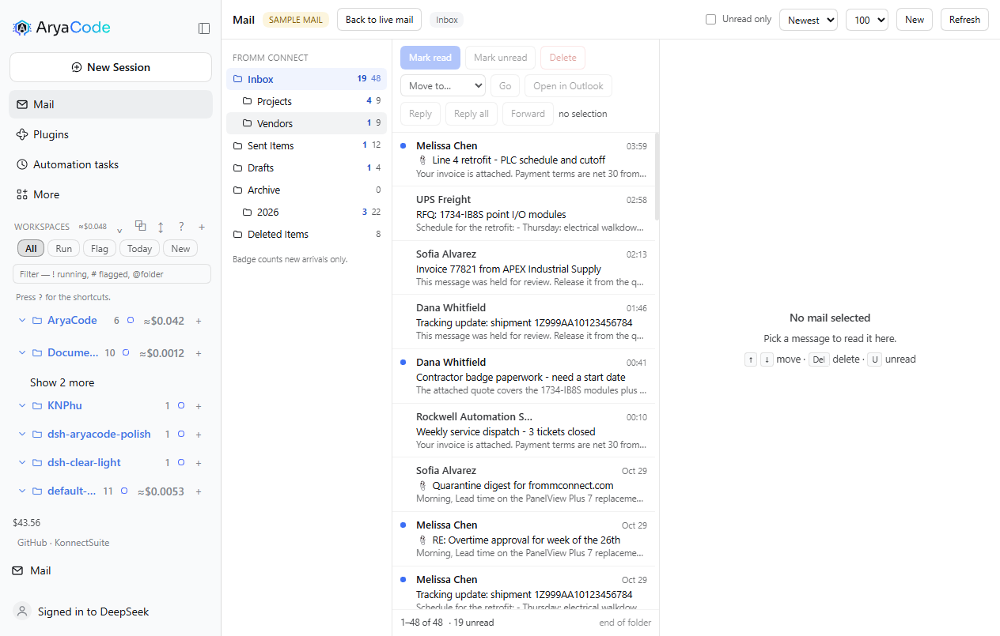

# dsh-arya-maildesk

> **Let an AI drive the Outlook you are already logged into, on a work laptop where IT will not give you a Graph API permission.**
> No credentials, no admin rights, and nothing leaves the machine without asking you first.

[](https://www.npmjs.com/package/@deepseek-ai/dsh) [](https://support.microsoft.com/en-us/office) [](./LICENSE) [](#what-it-delivers)

> **Where this came from.** It started as [UnknowCao/dsh-outlook](https://github.com/UnknowCao/dsh-outlook) at `5a2ec7d` (v2.11.0, MIT): a solid read/send bridge with 18 tools and a badge. The organize half was missing — delete, move/archive, read state, a folder tree, a paged listing — and the interface stopped at the badge, so the mail panel, the composer, the draft card and the Sidebar tab are new here. `NOTICE` keeps the upstream attribution; the upstream version line was retired at 1.0.0, see `CHANGELOG.md`.

*Zero-credential Outlook automation for AI agents on Windows: drives your local desktop Outlook client via COM. No Graph API app registration, no SMTP passwords, no tenant admin rights — everything that leaves the machine passes a three-layer human approval gate.*

## When do you need this?

1. **Your work laptop has classic Outlook, but IT will not let you register an Azure app.** Every Graph API route (outlook-mcp and friends) dies at app registration; this plugin never asks, because it drives the desktop client you are already signed into.
2. **You want the AI to be your mail secretary.** Ask "anything new?" when you sit down; say "reply to this one, Wednesday works" and it drafts, quotes the original, and shows you the result before anything is sent.
3. **You need a meeting and do not know who is free.** One sentence looks up a colleague's free/busy and finds an open room, and you still approve the invite before it goes out.

## What it delivers

**24 AI tools** — reads run on their own, anything that leaves the machine goes through a confirmation popup first:

| Tool | What it does | Gate |
|---|---|---|
| `maildesk_check_new` | New-mail arrivals pushed by the watcher (keeps the sidebar badge in sync) | read-only |
| `maildesk_search_mail` | Search mail (days / folder / sender / subject / date range / recipient side); results can carry a click-to-open link | read-only |
| `maildesk_read_mail` | Full body, recipients and attachment names, truncated when long | read-only |
| `maildesk_open_mail` | Open a mail in a desktop Outlook inspector window (marks it read, badge decrements) | local action |
| `maildesk_list_folders` | **The folder tree** of every store: path, depth, item and unread counts | read-only |
| `maildesk_list_mail` | **One page of a folder**, offset/limit, sortable, unread-only — browse, not search | read-only |
| `maildesk_move_mail` | **Move or archive** one mail or up to 500 at once; returns the new entryIds | local action |
| `maildesk_delete_mail` | **Delete** to Deleted Items (soft, undoable), with a selection-count guard | local action |
| `maildesk_mark_read` | **Mark read or unread**, in bulk | local action |
| `maildesk_account` | Account name and SMTP address | read-only |
| `maildesk_draft_mail` | Create a draft (**never sends**, attachments allowed) | safe |
| `maildesk_send_mail` | Send a mail | three-layer gate |
| `maildesk_reply_mail` | Reply / reply-all / forward (quotes the original, forward carries its attachments) | three-layer gate |
| `maildesk_calendar_query` | The next N days (recurring items expanded) | read-only |
| `maildesk_calendar_create` | Personal appointment directly; with attendees it becomes an invite | invites need approval |
| `maildesk_meeting_requests` | Pending meeting invitations | read-only |
| `maildesk_respond_meeting` | Accept / tentative / decline | approval (notifies the organizer) |
| `maildesk_meeting_update` | Change an appointment or meeting (organizer notifies attendees) | approval |
| `maildesk_meeting_cancel` | Cancel a meeting (notifies attendees) or drop a personal appointment | approval |
| `maildesk_search_people` | Address book (GAL) by name, email or alias | read-only |
| `maildesk_freebusy` | A colleague's busy/free blocks, 30-minute resolution | read-only |
| `maildesk_search_rooms` | Room search plus availability for a given window | read-only |
| `maildesk_save_attachment` | Save an attachment to disk (no path traversal, never overwrites) | local write |

**Plus a count on the Mail row.** New mail puts a red count on the envelope in the sidebar — arrivals **since you last opened the panel**, not the folder's unread total, so 141 unread sitting in the Inbox stays quiet until something new lands. Opening Mail marks it seen and clears the count. A `[Open](…)` markdown link in the chat still opens the mail in Outlook: the plugin intercepts the left click in-page, so there is no stray tab, and a toast confirms at the bottom.

The count has two sources: one `search_mail` from your last-seen timestamp when the app starts (mail that arrived while AryaCode was closed), and the `NewMailEx` watcher while it runs.

## The mail panel


A **Mail** icon in the sidebar opens a three-pane mailbox: folder rail, message list with a real selection (click, shift-range, ctrl-toggle), reading pane, and the organize actions — mark read or unread, move to a folder, delete to Deleted Items. A page loads 100 rows and pages on demand; the unread-only filter and the sort run in Outlook, not in the browser.

The data path is one allowlisted host route, `POST /maildesk/api/call`, guarded by the same origin check as the badge. It accepts `account`, `list_folders`, `list_mail`, `read_mail`, `search_mail`, `thread`, `mark_read`, `move_mail`, `delete_mail` and `open_mail`. **Sending is not on that list**, and cannot be reached through it.

No Outlook on this machine? A PC whose Outlook is the new WebView2 client has no COM surface at all, and the panel says so instead of showing an empty mailbox. From there, **Preview with sample mail** switches the panel (and the tools) to a synthetic mailbox so the interface can be seen and used; the header then reads `SAMPLE MAIL` with a **Back to live mail** button. Data is never mixed: the pill always says which one you are looking at.



`MAILDESK_FIXTURE=1` does the same thing for the whole session, without the button, and labels it `FIXTURE DATA` — that is the developer's switch. A COM failure is always reported as an error, never answered with invented mail.

### Reading mail safely


HTML bodies are parsed and rebuilt against an allowlist rather than injected: known tags and attributes survive, `<script>`, `<style>` and the embedding family are dropped with their contents, every `` becomes a *remote image blocked* chip so a tracking pixel never sends a read receipt, and only `http:`, `https:`, `mailto:` and `tel:` links survive with `rel="noopener noreferrer"`. Style properties are allowlisted too, so `url()`, `expression()` and `behavior` cannot come back in through CSS.

Proofpoint rewrites inbound URLs. The reader unwraps both the `urldefense.proofpoint.com/v2/url?u=…` and the `…/v3/__…__;…` forms, so a vendor link opens the vendor and the target you inspect is the one you will actually visit. The bridge returns `HTMLBody` raw — it is the renderer, which owns a document parser, that decides what survives.

### Replying from the panel


Reply, Reply all and Forward open a composer over the panel with the recipients already resolved from the thread, a `Re:` subject, and the quoted original rendered underneath the body. The draft is **not** an Outlook item: it lives in the host half, keyed by account and thread, so asking for the same reply twice reuses one draft instead of stacking a second in Outlook's Drafts folder. Nothing is written to Outlook until you send.


Sending is two steps on purpose. **Send…** asks the host for a confirmation hash over the exact arguments — recipients, subject and the final HTML body including the quote — and shows what will leave. **Send now** returns that hash; the host recomputes it and refuses a mismatch. Editing the draft between the two steps changes the hash, so a confirmation can never outlive the content it approved. The bridge keeps its own gate underneath: `compose_send` still demands the one-time `OLK_CONFIRM` token, and the host mints it only after a human has clicked through both steps.

The body is sent as `HTMLBody`, and the quote is rebuilt through a stricter path than the reading pane's: script, style, frames, forms and `on*=` handlers are removed **with their contents** before they are copied into an outbound message.

### The draft in the conversation


Asking the agent to draft a reply puts a card in the conversation instead of a line of JSON: the mode, the subject, the addressing, the body, and `[Edit in panel] [Send…] [Discard]`. The card is a keyed `tool.call.toolview` entry for the `maildesk_compose` tool, so it renders only that call and leaves every other tool row alone.

The card is a view of the same host-owned draft the panel edits, not a copy. There is no push channel from the host to the page in this harness, so the card polls `POST /maildesk/api/draft` with `op: "get"` and settles on whatever the panel last stored — editing in the panel and returning to the chat shows the edit. `Send…` uses the same two-step hash gate; `Edit in panel` switches to the Mail panel and opens the composer on that very draft, so there is still only one draft per thread no matter which surface started it.

### The draft beside the conversation


`[Open beside chat]` puts the same draft in a tab of the right Sidebar, so the thread you are answering stays on screen while you send. It is a real Sidebar tab — a `sidebarRightTabs` type plus its keyed `sidebar.right.pane.tab` body — not an overlay, so it collapses, splits and closes the way the harness's own tabs do.

The tab carries `[Send…] [Open in panel] [Discard]` and a `Close this tab` link, and it reads the draft from the same `op: "get"` route as the card. Sending from it cannot send stale content: if the draft changes between the preview and the confirmation, the retry no longer matches the hash and the tab asks you to send again rather than sending what you did not read.

### Conversations you can open

When Outlook groups a mail with others, the reader offers **`Conversation · N`**. Opening it lists every message in the thread in time order — sender, time, unread dot — with the one you were reading already expanded and the rest collapsed; clicking a row loads its body.

The bridge gets this from Outlook itself (`MailItem.GetConversation()`), not from subject matching, so a thread that changed subject mid-way still groups correctly. Bodies load one at a time, so a forty-message thread costs one call, not forty.

### Focused / Other

Two tabs above the message list split what is loaded: **Focused** for people, **Other** for senders that look automated (`noreply@`, notification digests, mailers).

**This is AryaCode's rule, not Outlook's.** Outlook keeps its Focused classification server-side and exposes nothing usable to a COM client — the item's property bag has no focus property, and a `Restrict` on the conversation id returns nothing. The tabs say as much in their tooltip. If you want Outlook's own split, use Outlook.

### Showing only the accounts you want

**Accounts** in the panel header lists every store in the Outlook profile. Unchecking one drops its folders from the rail, from `list_folders` as the agent sees it, and from the move picker — while Outlook keeps the account untouched and syncing. The choice is persisted and the last visible account cannot be hidden.

### The assistant, floating over the mail

The **Ask** pill at the bottom-right of the panel raises a card instead of taking a strip of the layout: the mailbox keeps its full height, and the card floats above it.

- **Drag** it by its header; it snaps to the nearest corner. **Resize** from the bottom-left grip; double-click the header to reset. It remembers where you put it.
- `Ctrl+J` toggles it, `Esc` collapses it, `Enter` sends, `Shift+Enter` breaks the line.
- It is the same agent as the chat — same session service, same `maildesk_*` tools, same confirmation gates — so anything that sends still asks you first.
- Questions and answers carry who and when; answers render light markdown (bold, bullets, inline code, links); consecutive tool calls collapse into one `N steps` line with a spinner while they run.
- A context chip shows what the next question rides on (`About: <subject> · N messages`); the × drops it for one question.

Polling is 700 ms while a turn runs and 5 s when idle. **One limitation**: the harness's `ask_user_question` popup belongs to the chat client, so the panel asks its questions **in plain text** instead — the turn is instructed never to call that tool. A question asked there arrives as a normal message you answer with your next message.

### Choosing the model

The chip in the card header names the model answering (`V4.1-Flash · High` on this deployment) and opens the host's catalog: **DeepSeek-V4.1-Flash** or **DeepSeek-V4-Pro**, each with Off / Low / High / Max. The choice goes through `sessionController.selectModel`, the same path the chat uses — which also means it becomes the deployment default, exactly as it does when you change the model in chat.

## Quick start

```sh
# from the Arya Plugin Market: Plugins → Arya Plugin Market → Mail desk → Install
# or from a terminal:
dsh plugin --profile web add @aryacode/dsh-arya-maildesk
```

Then restart the profile (or rely on `patchReload: live`). There is no second step — no credential, no app registration, no Outlook setting to change.

**Prerequisites**: Windows + classic desktop Outlook (Win32 `OUTLOOK.EXE`) signed in + Windows PowerShell 5.1 (ships with the OS). No tenant admin rights.

> Published as `@aryacode/dsh-arya-maildesk` 1.0.0. It coexists with upstream's `dsh-outlook`: different package, different tool prefix (`maildesk_*` vs `outlook_*`), so neither shadows the other.

## Try saying

- "Anything new?"
- "Find the mail from the vendor last week about the deliverables"
- "Forward this to Dana and ask her to confirm"
- "Set up a meeting with Wei next Wednesday — check when he is free first"
- "Find a room free tomorrow from two to three"

## How it differs from the alternatives

| | this plugin | Graph API (outlook-mcp etc.) | SMTP (mcp-server-email etc.) |
|---|---|---|---|
| Needs an Azure app registration | ❌ no | ✅ required (usually locked by IT) | ❌ |
| Needs mailbox credentials | ❌ | OAuth token | ✅ SMTP password |
| Sees the state of the client **you are using** (unread, rules, local folders) | ✅ | partial | ❌ |
| Human confirmation before anything is sent | three gates (below) | implementation-dependent | implementation-dependent |
| Platform | Windows, classic Outlook only | anything | anything |

## Security boundary

**Anything that leaves the machine — sending mail, dispatching an invite — passes three independent gates:**

1. **Two-call confirmation**: the first call only returns "here is what would be sent"; the AI must show it to you verbatim, and the call executes only on a retry carrying `confirmed:true` after you allow it.
2. **Content-hash binding**: the content shown at confirmation and the content actually sent are compared by SHA-256 — showing you A and sending B is rejected at the host layer and forced back through confirmation.
3. **Bridge token**: the PowerShell bridge independently refuses every send path without a one-time `OLK_CONFIRM` token. Even if a future bug or a new tool bypassed the first two gates, no token means no mail.

**What it will not do**: send anything silently; store or expose your mailbox credentials (it never sees them); auto-send a draft; write an attachment over an existing file or outside the chosen directory.

Known boundaries: the `/olk-notify/*` routes are reachable only from this host and same-origin checked (other local processes and non-browser requests can still read new-mail subject metadata); the port inside a chat "open" link does not matter for a plain left click, because the client intercepts by pathname and posts to the page's own origin; `/olk-notify/open` is POST-only, so a modifier-click or middle-click on a chat link gets 405 (deliberate; the `maildesk_open_mail` tool is unaffected); several tabs share one pending queue; `OLK_WATCH=0` turns the new-mail watcher off. Limits of this build: folder names are matched in English only (`Inbox`, `Sent Items`, `Drafts`, `Deleted Items`) — a mailbox whose folders are named in another language must be addressed by entryId; `delete_mail` is a soft delete to Deleted Items and there is no permanent-delete path; `move_mail` changes entryIds, so re-read the folder afterwards.

## Layout

```
index.js          host half: 24 tool registrations, the allowlisted panel route, the
                  assistant routes (ask, models), the accounts filter, the draft
                  store and compose routes, the fixture provider, two-call
                  confirmation, content hash, watcher management
client.js         browser half: the Mail panel (folders, list, reading pane, composer,
                  conversations, Focused/Other, accounts), the floating assistant
                  card, the draft card at tool.call.toolview, the right-Sidebar
                  draft tab, and the new-arrival count on the Mail row
lib/olk.ps1       the COM bridge: every Outlook operation, the token gate, the
                  resident loop, and the localization quirks (see the file header)
lib/watch.ps1     NewMailEx resident listener: pushes arrivals, self-heals after 30s
cordis.patch.yml  host row declaration
test/             offline suites: the panel and assistant routes driven through fake
                  req/res, a fake COM model, fixture mail, and the PowerShell bridge
NOTICE            upstream attribution (MIT) and the pinned base commit
UPSTREAM.md       how this build relates to upstream, and how to diff it
TESTCASES.md      what is covered where, and the checks that need a real mailbox
CHANGELOG.md      version narrative (why before what)
```

Diagnostic log: `%TEMP%\dsh-arya-maildesk-watch-debug.log` (rotated at 1 MB).

## Verification and tests

**178 assertions, seven suites, all run offline** (`npm test`):

| Suite | Assertions | What it pins down |
|---|---|---|
| `test/bundle.test.mjs` | 15 | the browser bundle is one hand-written module: no build step, no imports, one `__ModuleLoader__` entry, and the host/panel route names match the client's |
| `test/panel-api.test.mjs` | 29 | the panel routes through fake `req`/`res`: the action allowlist, paging and every row field, the hostile-HTML fixture, mark read, move, delete, the confirmation hash (missing → `needs-confirmation`, wrong → refused, matching → sent once), draft reuse, and 403/405/400 on the transport edges |
| `test/ask-route.test.mjs` | 29 | the in-panel assistant: one session reused across questions, the panel context in the prompt, the ground rules that forbid `ask_user_question`, the turn markers behind `running`, message timestamps, `cancel`, `new`, and transcript filtering of harness injections |
| `test/accounts.test.mjs` | 8 | hiding an account: the store list, the refusal to hide the last one, persistence, and that the mailbox itself is untouched |
| `test/models.test.mjs` | 10 | the model route: catalog passthrough, selection, lazy session creation, and 400/405 on bad input |
| `test/drafts-persist.test.mjs` | 11 | drafts survive a host restart, reuse on the same thread, and the discard path |
| `test/sample-mail.test.mjs` | 17 | the fixture mailbox: labelled data, the pill, and that a COM failure is an error rather than invented mail |
| `test/run-all.ps1` | 59 | the **real** PowerShell case bodies against a fake COM model: folder resolution, paging with a skipped non-mail item, sorting, preview truncation, unread-only, move returning new entryIds and isolating per-item failures, the `expected` count gate refusing **and deleting nothing**, mark read both ways, and the folder-tree BFS |

**What has been verified on a real mailbox** (an Exchange profile with three stores, ~545 folders):

- account / folders / list / read / mark read / move / delete / open, counts restored after every test;
- compose, reply-all with Exchange senders (`EX:/O=…` resolved to SMTP), and **one real send by the owner** through the panel's confirmation;
- conversations (a four-message thread across three people), Focused/Other (82 / 18 on the first page), account hiding, the new-arrival count, and the floating assistant answering a live question;
- the model picker switching Flash ↔ V4-Pro and back.

**What is still manual**: dragging and resizing the assistant card, and pressing Stop mid-answer (no automated coverage; the click paths were exercised by hand). COM quirks — two-stage Jet/DASL filtering, the `Restrict` date format, `IncludeRecurrences` reporting MaxInt, PowerShell 5.1 stdin encoding — are encoded in `lib/olk.ps1` and were verified against Exchange by the upstream author.

## Where it appears in the app

| What you see | What it is |
|---|---|
| **Mail** row in the sidebar | opens the mail panel: folder rail, message list, reading pane, composer |
| A red count on that row's envelope | mail that arrived **since you last opened** the panel; opening it clears the count |
| **Accounts** in the panel header | hide a store from AryaCode without touching Outlook |
| **Ask** pill, bottom-right of the panel | the floating assistant (`Ctrl+J`), with its model chip in the header |
| `maildesk_*` tools | what the agent calls; they answer from the same mailbox the panel shows |
| A card in the conversation | a draft the agent composed — edit it, send it, or discard it |
| A **Mail draft** tab at the right | the same draft, beside the conversation, while you keep chatting |

## First run

Open **Mail**, click a folder, click a message. That exercises the whole read path (`list_folders` → `list_mail` → `read_mail`) before anything writes. If the reading pane shows a red explanation instead of a message list, the bridge could not reach Outlook — see *Troubleshooting*.

## Settings

There is no settings screen. These environment variables change behaviour, read when the host half starts:

| Variable | Default | Effect |
|---|---|---|
| `MAILDESK_FIXTURE` | unset | `1` serves a synthetic mailbox (~100 mails, hostile HTML, all folders) instead of COM — for reviewing the interface on a machine without Outlook. The panel then shows a `FIXTURE DATA` pill. Never reads or writes real mail. |
| `OLK_WATCH` | unset | `0` turns the new-mail watcher off (no count on the Mail row, no `check_new` queue); useful when you do not want a resident PowerShell listener. |
| `MAILDESK_NO_RESIDENT` | unset | `1` stops the resident bridge process and pays a PowerShell start per call. The fallback for a machine where a long-lived child is not allowed (some sandboxes). |
| `MAILDESK_STATE_FILE` | `%TEMP%\dsh-arya-maildesk-ask.json` | where the assistant's session id is remembered, so the thread survives a restart. |
| `MAILDESK_DRAFTS_FILE` | `%TEMP%\dsh-arya-maildesk-drafts.json` | where the harness-owned drafts are kept. |
| `MAILDESK_ACCOUNTS_FILE` | `%TEMP%\dsh-arya-maildesk-accounts.json` | where the hidden-account choice is kept. |

The model is not an environment variable: it is the harness's own selection, changed from the assistant's header chip (or from chat), and it follows you between the two.

## Remove

```sh
dsh plugin --profile <profile> remove @aryacode/dsh-arya-maildesk
```

Nothing of yours is deleted from Outlook, and the plugin leaves three small files in `%TEMP%` that you can remove yourself: `dsh-arya-maildesk-ask.json` (the assistant's session id), `dsh-arya-maildesk-drafts.json` (harness-owned drafts), `dsh-arya-maildesk-accounts.json` (which accounts you hid), plus `dsh-arya-maildesk-watch-debug.log`. If you staged the tarball from the market, `<profile>\.dsh-market\releases\` keeps a copy — harmless, and shared with anything else installed from the market.

## Troubleshooting

**The panel says "No classic Outlook answered on this machine."**
You are on the new Outlook for Windows (the WebView2 client), or Office is installed without Outlook. The new client has no COM surface — this is a property of the client, not a setting. Use a machine with classic Outlook, or click **Preview with sample mail** in the panel (or set `MAILDESK_FIXTURE=1`) to work on the interface with synthetic mail.

**The assistant sits on "Working…" with one step called `ask_user_question`.**
That tool's popup belongs to the chat client; raised from the panel it waits on a surface that is not there. The panel's prompt forbids it, so this should not happen — if it does, press **Stop** and ask again. The turn is not lost.

**Changing the model changed it in chat too.**
Expected: the panel selects through the harness, and the harness saves the choice as the deployment default. Set it back from either place.

**A send is refused with `SEND BLOCKED: no human confirmation token`.**
That is the third gate doing its job: something tried to send without going through the panel's or the card's confirmation. Send again from the panel or the card, where confirming is a click.

**Nothing in the sidebar, or the tools are missing.**
**Nothing in the sidebar, or the tools are missing.**
The host half did not activate. Restart the profile and check the app log for `did not activate`, `import failed` or `duplicate factory`. If `dsh-outlook` is also installed, that is fine — the tool prefixes differ (`outlook_*` vs `maildesk_*`).

**Search finds nothing for a word you can see in a mail.**
`maildesk_search_mail` filters through Outlook's own query engine, which is stricter than a text search. Narrow by folder and date first; the two-stage Jet/DASL filter is described in `lib/olk.ps1`'s header.

## Licence

MIT. This is a fork of [UnknowCao/dsh-outlook](https://github.com/UnknowCao/dsh-outlook) at `5a2ec7d` (MIT) — see [NOTICE](./NOTICE) for the attribution and [UPSTREAM.md](./UPSTREAM.md) for what was kept, what was replaced, and how to diff against upstream.
